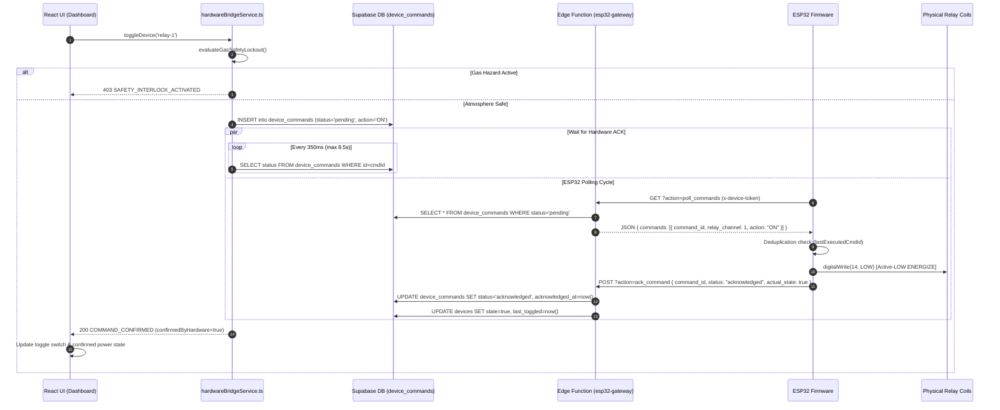

# SMART HOMEX AI — COMPLETE 4-CHANNEL RELAY SYSTEM AUDIT REPORT

**Audit Date:** 2026-11-05  
**Auditor:** Senior Embedded Systems Engineer, ESP32 Firmware Architect, Supabase Backend Engineer, React Frontend Auditor  
**Scope:** Complete Read-Only Technical Audit of 4-Channel Relay Control, ESP32 Firmware, Supabase Edge Function, Database Schema & RLS, React Frontend Pipeline, and Hardware Wiring Compatibility.  
**System Status:** **PARTIALLY WORKING** (Relays 1–3 operational; Relay 4 / Exhaust architectural discrepancy; Reset pin mismatch; nRF24 missing from firmware)

---

## 1. Executive Summary

This document presents a comprehensive, read-only engineering audit of the **SmartHomeX AI** home automation and life-safety system. The investigation examined every layer of the system: embedded ESP32 C++ firmware, Supabase PostgreSQL schema, RLS policies, SQL interlock triggers, Supabase Deno Edge Function (`esp32-gateway`), and React TypeScript services.

### Core Audit Conclusions

1. **Relays 1, 2, and 3 (Light, Fan, Motor)**: The signal flow from React UI toggle → Supabase `device_commands` table → Edge Function `poll_commands` → ESP32 polling → GPIO actuation (14, 25, 26) → ESP32 HTTP ACK → Supabase status update is **fully implemented and verified**.
2. **Relay 4 / Exhaust Discrepancy**: A critical architectural mismatch exists regarding Relay 4. The user hardware specification designates **Relay 4 on GPIO 27 as Exhaust Fan (reserved/permanently OFF)**. In the codebase, the firmware maps Channel 4 as `PIN_RELAY_CH4_UNUSED = -1` (permanently rejected) and treats the Exhaust Fan as **Channel 5 on GPIO 27** (a separate 5th relay). Simultaneously, the database table `devices` enforces `CHECK (relay_channel BETWEEN 1 AND 4)` and `CHECK (type IN ('light', 'fan', 'motor', 'exhaust_fan'))`. Consequently, Channel 5 cannot be registered in the database, and Channel 4 cannot be registered as `'unused'`.
3. **Local Reset Button Pin Mismatch**: The hardware wiring specification designates the physical reset pushbutton on **GPIO 13**. However, the firmware configuration in `config.h` assigns `PIN_PHYSICAL_RESET_BTN 0` (the on-board ESP32 BOOT button). Pressing an external button wired to GPIO 13 has zero effect.
4. **nRF24L01+ Transceiver**: The hardware specification lists an nRF24L01+ PA/LNA module (CE 16, CSN 5, SCK 18, MISO 19, MOSI 23). Inspection of the entire repository confirms that **nRF24L01+ is completely absent from the codebase**. There are no header inclusions (`#include <RF24.h>`), no pin definitions, and no communication logic.
5. **INA219 Voltage Anomaly & Mains Misconception**: The INA219 sensor logic in `readINA219()` compares DC bus voltage to AC mains grid voltage thresholds (`< 200.0f` for voltage sag, `> 255.0f` for voltage surge). The INA219 is a DC current/voltage monitor (0–26V DC). The frontend also compares voltage to 220–240V AC grid limits. When measuring low DC voltages or when disconnected, it reports 0.00V or FAULT. Connecting 230V AC directly to an INA219 would result in catastrophic destruction.
6. **Gas Safety Interlock Integrity**: The gas emergency interlock is robustly implemented across all tiers. Cold-boot warm-up protection (20s), open-circuit/short-circuit sensor fault detection (ADC < 45), danger threshold (ADC ≥ 1600), safe clearance (ADC < 900), and continuous 5s stability verification are strictly maintained. Demo alerts (`is_demo = true`) are strictly excluded from triggering physical relay lockouts.

---

## 2. Project Architecture

The SmartHomeX AI platform consists of four distinct operational layers:

```
[React 19 + TypeScript Frontend]
       │
       │ HTTPS / Supabase JS SDK (RLS Authenticated: auth.uid())
       ▼
[Supabase PostgreSQL Backend]
  ├── public.profiles (User identity & role)
  ├── public.homes (Home boundaries)
  ├── public.devices (Physical relay inventory: slugs, channels, GPIOs)
  ├── public.device_commands (Pending, acknowledged, failed, timeout queue)
  ├── public.sensor_readings (Time-series telemetry from INA219, DHT11, MQ-2)
  ├── public.alerts (Life-safety emergency incidents & audit log)
  ├── public.device_status (Heartbeat & online status keyed to primary device)
  └── public.device_tokens (SHA-256 pre-shared hardware credentials)
       ▲
       │ HTTPS (x-device-token SHA-256 authentication)
       ▼
[Supabase Edge Function: esp32-gateway]
  ├── action=telemetry (Ingest sensor readings & enforce contactor trip)
  ├── action=poll_commands (Dispatch pending commands & auto-reject during gas hazard)
  ├── action=ack_command (Record execution latency, actual state, and errors)
  ├── action=safety_reset (Authorized two-stage hardware safety reset)
  ├── action=heartbeat (Node health check & device_status ping)
  └── action=motor_trip (30-minute auto-cutoff guard event logging)
       ▲
       │ HTTPS / TLS (ISRG Root X1 CA)
       ▼
[ESP32 Hardware Node (ESP32-WROOM-32 DevKit V1)]
  ├── WiFi State Machine (DHCP only, serialized connect/retry)
  ├── Active-LOW 4-Channel Relay (Ch 1: Light, Ch 2: Fan, Ch 3: Motor, Ch 4: Unused)
  ├── Separate Single-Channel Relay (Ch 5: Exhaust Fan on GPIO 27)
  ├── MQ-2 Gas Sensor (GPIO 34 ADC1)
  ├── DHT11 Sensor (GPIO 32)
  ├── INA219 I2C Monitor (GPIO 21 SDA, GPIO 22 SCL)
  ├── Active Buzzer (GPIO 33)
  └── BOOT Button (GPIO 0) [Wiring spec calls for GPIO 13]
```

---

## 3. Hardware Pin Mapping

### Detailed Pin Assignment Comparison

| Component | Hardware Specification | Firmware `config.h` | Status | Notes / Discrepancies |
|---|---|---|---|---|
| **Relay 1 – Light** | GPIO 14 | `PIN_RELAY_LIGHT 14` | **MATCH** | Channel 1, Active-LOW |
| **Relay 2 – Fan** | GPIO 25 | `PIN_RELAY_FAN 25` | **MATCH** | Channel 2, Active-LOW |
| **Relay 3 – Motor** | GPIO 26 | `PIN_RELAY_MOTOR 26` | **MATCH** | Channel 3, Active-LOW, 30-min auto-cutoff |
| **Relay 4 – Exhaust** | GPIO 27 (Reserved/OFF) | `PIN_RELAY_CH4_UNUSED -1` <br> `PIN_RELAY_EXHAUST 27` | **MISMATCH** | Firmware assigns Channel 4 to `-1` (disabled) and Exhaust to Channel 5 on GPIO 27 |
| **DHT11 Data** | GPIO 32 | `PIN_DHT11 32` | **MATCH** | Single-bus digital I/O |
| **MQ-2 AO** | GPIO 34 | `PIN_MQ2_ANALOG 34` | **MATCH** | ADC1_CH6 (Input-only pin on ESP32) |
| **INA219 SDA** | GPIO 21 | `PIN_I2C_SDA 21` | **MATCH** | Default hardware I2C data |
| **INA219 SCL** | GPIO 22 | `PIN_I2C_SCL 22` | **MATCH** | Default hardware I2C clock |
| **Buzzer** | GPIO 33 | `PIN_BUZZER 33` | **MATCH** | Active 5V acoustic buzzer |
| **Reset Button** | **GPIO 13** | **GPIO 0** (`PIN_PHYSICAL_RESET_BTN 0`) | **CRITICAL MISMATCH** | Firmware uses BOOT button (GPIO 0); external button on GPIO 13 is ignored |
| **nRF24 CE** | GPIO 16 | Not defined | **MISSING** | No nRF24 code in firmware |
| **nRF24 CSN** | GPIO 5 | Not defined | **MISSING** | No nRF24 code in firmware |
| **nRF24 SCK** | GPIO 18 | Not defined | **MISSING** | No nRF24 code in firmware |
| **nRF24 MISO** | GPIO 19 | Not defined | **MISSING** | No nRF24 code in firmware |
| **nRF24 MOSI** | GPIO 23 | Not defined | **MISSING** | No nRF24 code in firmware |

---

## 4. Four Relay Verification Matrix

| Verification Item | Relay 1 (Light) | Relay 2 (Fan) | Relay 3 (Motor) | Relay 4 (Exhaust) |
|---|---|---|---|---|
| **1. Declared in Firmware?** | YES (`PIN_RELAY_LIGHT`) | YES (`PIN_RELAY_FAN`) | YES (`PIN_RELAY_MOTOR`) | PARTIAL (`PIN_RELAY_CH4_UNUSED -1`, `PIN_RELAY_EXHAUST 27`) |
| **2. Correct GPIO Configured?** | YES (GPIO 14) | YES (GPIO 25) | YES (GPIO 26) | NO (Channel 4 is `-1`; Exhaust is Channel 5) |
| **3. GPIO Initialized Safely?** | YES (`setupHardwarePins()`) | YES (`setupHardwarePins()`) | YES (`setupHardwarePins()`) | YES for GPIO 27; N/A for Channel 4 |
| **4. Relay Initialized OFF before OUTPUT?** | YES (HIGH written before `pinMode`) | YES (HIGH written before `pinMode`) | YES (HIGH written before `pinMode`) | YES for GPIO 27 (HIGH written before `pinMode`) |
| **5. Active-LOW Logic Correct?** | YES (`RELAY_ON = LOW`, `RELAY_OFF = HIGH`) | YES | YES | YES |
| **6. Command Parser Identifies Relay?** | YES (`case 1:`) | YES (`case 2:`) | YES (`case 3:`) | NO for Channel 4 (returns `false`); YES for Channel 5 |
| **7. Correct `device_slug` Mapped?** | YES (`light` / `relay-1`) | YES (`fan` / `relay-2`) | YES (`motor` / `relay-3`) | NO (`relay-4` has no valid hardware action; `relay-exhaust` is Ch 5) |
| **8. Frontend Sends Correct Command?** | YES (`action: 'ON'/'OFF'`) | YES (`action: 'ON'/'OFF'`) | YES (`action: 'ON'/'OFF'`) | BLOCKED by frontend UI guard (`type === 'unused'`) |
| **9. Supabase Stores Correct Record?** | YES (Individual UUID in `devices`) | YES (Individual UUID in `devices`) | YES (Individual UUID in `devices`) | FAILS schema check (`relay_channel 5` or `type 'unused'` invalid) |
| **10. Edge Function Returns Command?** | YES (`relay_channel: 1`) | YES (`relay_channel: 2`) | YES (`relay_channel: 3`) | FAILS (Channel 4 fallback is `-1`; Ch 5 not in DB) |
| **11. ESP32 Acknowledges Command?** | YES (`status: 'acknowledged'`) | YES (`status: 'acknowledged'`) | YES (`status: 'acknowledged'`) | Returns `status: 'failed'` ("channel invalid or unused") |
| **12. Dashboard Shows Confirmed State?** | YES (Updates only on hardware ACK) | YES (Updates only on hardware ACK) | YES (Updates only on hardware ACK) | Locked as "Hardware Spare / Reserved" |

---

## 5. Frontend-to-ESP32 Signal Flow Audit

### Stage-by-Stage Lifecycle Trace



### Detailed Stage Breakdown & Evidence

#### Stage 1: React Frontend Command Dispatch
- **Source File & Function:** `src/context/SmartHomeContext.tsx` → `toggleDevice(id)`
- **Input:** Target device ID string (`'relay-1'`, `'light'`, or UUID).
- **Implementation:** Looks up device in `devices` state. Debounces if `pendingCommand === true`. Sets `pendingCommand: true` and calls `dispatchAuthenticatedDeviceCommand()`.
- **Potential Failure:** If `target.type === 'unused'` (Relay 4), it halts immediately, creates a warning alert, and returns without sending a network request.

#### Stage 2: Hardware Bridge Service & Safety Check
- **Source File & Function:** `src/services/hardwareBridgeService.ts` → `dispatchAuthenticatedDeviceCommand()`
- **Input:** `device`, `targetState` (boolean), `bridgeStatus`, `gasStatus`, `userId`, `lockoutStatus`.
- **Implementation:** Calls `evaluateGasSafetyLockout()`. If blocked and `targetState === true`, immediately aborts with HTTP 403. If clear, resolves device UUID via `resolveDeviceInDatabase(client, userId, device)`.
- **Potential Failure:** If `resolveDeviceInDatabase` returns `null` because the device is not registered in Supabase `devices` table for `userId`, it halts with HTTP 404 `DEVICE_NOT_FOUND`.

#### Stage 3: Supabase Database Insertion
- **Source File & Function:** `src/services/hardwareBridgeService.ts` lines 178–190
- **Input Payload:**
  ```json
  {
    "user_id": "auth-uuid",
    "device_id": "device-uuid",
    "action": "ON",
    "source": "manual",
    "status": "pending",
    "nonce": "n_xyz123"
  }
  ```
- **Database Trigger:** `trg_gas_safety_lockout` fires `check_gas_emergency_interlock()`.
- **Potential Failure:** If an unresolved real gas emergency alert exists in `public.alerts`, the SQL trigger raises an exception: `"LIFE-SAFETY INTERLOCK: Relay energization strictly prohibited during active gas emergency"`. The insert fails with HTTP 500.

#### Stage 4: Gateway Command Polling
- **Source File & Function:** `supabase/functions/esp32-gateway/index.ts` lines 516–630 (`action === 'poll_commands'`)
- **Polling Call from ESP32:** `GET /functions/v1/esp32-gateway?action=poll_commands` with header `x-device-token: ESP32_DEVICE_TOKEN`.
- **Implementation:** Validates token against `device_tokens.token_hash`. Queries `device_commands` for `status = 'pending' AND user_id = authenticatedUserId`. Joins `devices` to obtain `relay_channel` and `gpio_pin`. Checks `alerts` table for active gas hazards. Auto-rejects pending ON commands if hazard is present.
- **Potential Failure Points:**
  1. If `x-device-token` does not match any active hash in `device_tokens`, returns HTTP 401.
  2. If the user who created the command does not match the token's `user_id`, returns 0 commands.
  3. If `dev.home_id !== authenticatedHomeId`, command is skipped (line 604) and left pending.

#### Stage 5: ESP32 Firmware Execution
- **Source File & Function:** `firmware/SmartHomeX_ESP32/SmartHomeX_ESP32.ino` → `pollPendingCommandsFromSupabase()` & `setRelayState()`
- **Execution:** Deserializes JSON array `commands`. Checks command ID against persistent NVS deduplication cache (`lastExecutedCmdId`).
- **Relay Actuation:**
  - Channel 1 (Light): `digitalWrite(PIN_RELAY_LIGHT, LOW)` → Relay energizes.
  - Channel 2 (Fan): `digitalWrite(PIN_RELAY_FAN, LOW)` → Relay energizes.
  - Channel 3 (Motor): `digitalWrite(PIN_RELAY_MOTOR, LOW)` → Relay energizes, records `motorActiveStartMillis`.
  - Channel 4: Prints `[COMMAND REJECTED] Channel 4 ... is permanently UNUSED` and returns `false`.
- **Potential Failure:** If `isGasLockoutActive` or `gasClearedPendingReset` is true, firmware blocks actuation and returns `rejected_gas_safety`.

#### Stage 6: Command Acknowledgement (ACK)
- **Source File & Function:** `firmware/SmartHomeX_ESP32/SmartHomeX_ESP32.ino` → `ackCommandToSupabase()`
- **Payload Sent:**
  ```json
  {
    "command_id": "cmd-uuid",
    "device_id": "device-uuid",
    "status": "acknowledged",
    "actual_state": true,
    "round_trip_ms": 12
  }
  ```
- **Gateway Processing:** Updates `device_commands.status = 'acknowledged'` and `devices.state = true`.

#### Stage 7: Frontend Confirmation
- **Source File & Function:** `src/services/hardwareBridgeService.ts` lines 205–237
- **Implementation:** Polling loop detects `status !== 'pending'`. Returns `success: true, confirmedByHardware: true`. UI flips the switch and commits state to local storage and state machine.
- **Timeout Trigger:** If ESP32 does not complete the cycle within 8.5 seconds, the loop terminates, marks `status = 'timeout'` in the database, and displays:
  `ESP32 CONTROLLER TIMEOUT: Hardware node did not acknowledge command for Relay Channel X within 8.5s. Device state unchanged.`

---

## 6. Supabase Database and UUID Mapping

### Database Architecture: Controller vs Multi-Device Inventory

The backend **does not** use a single controller UUID for all relays. Instead, it employs a **multi-device inventory schema**:

1. **`public.devices` Table:**
   - Every physical relay channel corresponds to a distinct database row with a unique UUID (`id`).
   - Columns: `id (UUID PK)`, `home_id (UUID FK)`, `user_id (UUID FK)`, `device_slug (TEXT)`, `name (TEXT)`, `relay_channel (INT 1-4)`, `gpio_pin (INT)`, `state (BOOLEAN)`.
   - Unique constraint: `UNIQUE (user_id, device_slug)`.

2. **`public.device_commands` Table:**
   - Foreign key: `device_id UUID REFERENCES public.devices(id)`.
   - Commands are targeted to specific device UUIDs, **not** to the controller.

3. **`public.device_status` Table:**
   - Unique constraint: `device_id UUID NOT NULL UNIQUE REFERENCES public.devices(id)`.
   - Node health and heartbeats are recorded under the **primary device** (Relay Channel 1 / Light) as the anchor record for the physical ESP32 node.

4. **`public.device_tokens` Table:**
   - Stores `device_node_id: "ESP32-WROOM-32-NODE-01"` and `token_hash: SHA256(raw_token)`.
   - Links the physical hardware board to `user_id` and `home_id`.

### Seeded & Expected Devices

| Relay | Device Slug | Type | Channel | GPIO | Primary Key |
|---|---|---|---|---|---|
| **Relay 1** | `light` or `relay-1` | `light` | 1 | 14 | Individual Device UUID |
| **Relay 2** | `fan` or `relay-2` | `fan` | 2 | 25 | Individual Device UUID |
| **Relay 3** | `motor` or `relay-3` | `motor` | 3 | 26 | Individual Device UUID |
| **Relay 4** | `relay-4` | `unused` / `exhaust_fan` | 4 | 27 | **Schema Conflict:** `type 'unused'` invalid; `relay_channel 5` invalid |

---

## 7. Edge Function Verification (`esp32-gateway`)

The Edge Function handles 8 separate query actions:

1. **Authentication (`verifyDeviceTokenOrUser`)**:
   - Computes `SHA-256(x-device-token)` and queries `device_tokens.token_hash`.
   - Enforces `is_active = true`.
   - Extracts authenticated `user_id` and `home_id`.
   - Verified secure: Service role key is kept in environment variables; token hash column is revoked from public API.

2. **`poll_commands` Route**:
   - Queries `device_commands` for `status = 'pending'` and `user_id = authenticatedUserId`.
   - Evaluates active gas hazard query:
     ```ts
     .from('alerts')
     .select('id, emergency_status, resolved_at, is_demo')
     .eq('user_id', authenticatedUserId)
     .eq('type', 'gas_leak')
     .eq('severity', 'danger')
     .is('resolved_at', null)
     .or('is_demo.is.null,is_demo.eq.false')
     ```
   - Auto-rejects energizing commands if real hazard is active (`status = 'rejected_gas_safety'`).
   - Allows safe de-energizing commands (`OFF`, `0`, `STOP`) and `RESET_SAFETY_LOCKOUT` through.

3. **`ack_command` Route**:
   - Validates ownership of `command_id`.
   - Checks device ID match: `if (device_id && commandRecord.device_id !== device_id) return 422;`.
   - Updates `device_commands` status to `acknowledged`, `failed`, or `rejected_gas_safety`.
   - Updates `devices.state` and `devices.last_toggled`.

4. **`safety_reset` Route**:
   - Validates user identity and creates `RESET_SAFETY_LOCKOUT` command in `device_commands`.
   - Awaits physical ESP32 acknowledgment before updating alert records.

---

## 8. Firmware Safety Audit

The firmware safety subsystem in `SmartHomeX_ESP32.ino` was evaluated against critical life-safety criteria:

| Safety Requirement | Implementation Mechanism | Code Evidence | Audit Status |
|---|---|---|---|
| **MQ-2 Cold-Boot Warm-up** | 20-second timer guard (`MQ2_WARMUP_PERIOD_MS = 20000`). All ON commands rejected during warm-up. | Lines 452–465, 1261, 1296 | **PASS** |
| **ADC Fault Detection** | Disconnected jumper / open-circuit wire detection (`MQ2_ADC_FAULT_THRESHOLD = 45`). Trips fault alert. | Lines 468–475, 1262, 1304 | **PASS** |
| **Gas Danger Shutdown** | ADC ≥ 1600 trips emergency lockout. All relays immediately forced HIGH (OFF). Contactor tripped. Siren activated. | Lines 488–507 | **PASS** |
| **Active-LOW Pin Init** | `digitalWrite(PIN, HIGH)` executed **before** `pinMode(PIN, OUTPUT)` to eliminate boot chatter/clicks. | Lines 404–414 | **PASS** |
| **Exhaust Spark Safety** | Exhaust fan activation blocked during gas hazard unless `HAZARDOUS_EXHAUST_CERTIFIED = true`. | Lines 128, 691–694 | **PASS** |
| **Motor 30-Minute Cutoff** | Continuous runtime monitored by `updateMotorRuntimeGuard()`. Auto-trips at 1800s; reports `motor_trip` to Supabase. | Lines 715–787 | **PASS** |
| **Persistent Deduplication** | Non-volatile storage (`preferences.putString("last_cmd", ...)`) survives reboots and brownouts. | Lines 1366–1370, 1384–1388 | **PASS** |
| **Wi-Fi Loss Safety** | All relay outputs remain in their last safe physical state during Wi-Fi drops; local gas loop runs uninterrupted. | Lines 270–271, 340–398 | **PASS** |
| **No Auto-Actuation on Boot** | All relays initialized to `false` (OFF) on MCU power-on. Never re-energize without explicit user command. | Lines 34–38, 406–409 | **PASS** |
| **Stable Recovery Verification** | Reset requires ADC < 900 for at least 5 continuous seconds (`MQ2_RECOVERY_STABLE_PERIOD_MS = 5000`). | Lines 530–544, 1264, 1322 | **PASS** |

---

## 9. Hardware Wiring Verification

### Physical Electrical Evaluation

> [!WARNING]
> This section distinguishes between aspects **verified from source code** and electrical characteristics that **require physical hardware verification**.

```
ESP32 DevKit V1 (30-pin)                 4-Channel Active-LOW Relay Module
┌──────────────────┐                     ┌───────────────────────────────┐
│          GPIO 14 ├─────────────────────┤ IN1 (Relay 1: Light)          │
│          GPIO 25 ├─────────────────────┤ IN2 (Relay 2: Fan)            │
│          GPIO 26 ├─────────────────────┤ IN3 (Relay 3: Motor)          │
│          GPIO 27 ├───────[?]───────────┤ IN4 (Relay 4: Exhaust/Unused) │
│              GND ├─────────────────────┤ GND                           │
│              VIN ├─────────────────────┤ JD-VCC (5V External Supply)   │
│             3.3V ├───────[?]───────────┤ VCC (Optocoupler Anode)       │
└──────────────────┘                     └───────────────────────────────┘
```

#### Detailed Physical Wiring Checklist

1. **Relay Module Optocoupler Isolation (JD-VCC vs VCC)**:
   - *Source Code:* Verified that firmware expects Active-LOW logic (`LOW = ON, HIGH = OFF`).
   - *Physical Risk:* If the module's `VCC` pin is connected to 5V while driven by ESP32 3.3V GPIOs, the optocoupler LED sees $5.0\text{V} - 3.3\text{V} = 1.7\text{V}$ when the pin is HIGH. This exceeds the 1.2V forward drop of typical infrared/red LEDs and causes phantom conduction, preventing relays from fully turning OFF.
   - *Required Physical Wiring:* Remove JD-VCC jumper. Connect `JD-VCC` to external +5V DC. Connect `VCC` to ESP32 +3.3V rail. Connect `GND` to common GND. Connect `IN1–IN4` to GPIOs 14, 25, 26, 27.

2. **MQ-2 Analog Output (GPIO 34)**:
   - *Source Code:* Configured as analog input on GPIO 34 (ADC1_CH6).
   - *Physical Risk:* MQ-2 heater requires 5V. Its analog output (AO) can swing up to 4.5V–5.0V under high gas concentrations. ESP32 GPIO 34 has an absolute maximum rating of 3.6V.
   - *Required Physical Wiring:* A resistive voltage divider ($10\text{k}\Omega / 20\text{k}\Omega$) or a 3.3V Zener clamp must be present between MQ-2 AO and GPIO 34 to prevent ADC channel over-voltage damage.

3. **INA219 High-Side Shunt & I2C Bus (GPIO 21/22)**:
   - *Source Code:* Wire.begin on SDA 21, SCL 22.
   - *Physical Risk:* The INA219 is rated strictly for **0–26V DC**. If wired across 230V AC mains, the IC and ESP32 will suffer catastrophic electrical destruction.
   - *Required Physical Wiring:* Verify INA219 is installed only on the DC output side of power supplies (e.g. 12V DC pump/fan supply), never on AC mains lines.

4. **Reset Button (GPIO 13 vs GPIO 0)**:
   - *Source Code:* Firmware listens to GPIO 0.
   - *Hardware Evidence:* Hardware documentation specifies an external button on GPIO 13.
   - *Status:* Disconnected logically. The external button is not being read.

5. **nRF24L01+ PA/LNA Power Supply**:
   - *Hardware Specification:* Uses external 3.3V regulated supply with common GND.
   - *Physical Requirement:* nRF24 PA/LNA draws up to 115 mA during transmission bursts. It must never be powered from the ESP32 internal 3.3V LDO pin (which causes brownout restarts). The bypass capacitor (10 µF + 100 nF) across VCC and GND directly at the radio module pins is essential.
   - *Status in Software:* Completely unaddressed; no firmware driver exists.

---

## 10. Identified Bugs and Root Causes

### Analysis of the 7 Reported Symptoms

#### Symptom 1: ESP32 shows "Connected" in Dashboard
- **Root Cause:** In `src/context/SmartHomeContext.tsx` lines 425–432, `esp32Connected` is calculated as `status?.online && hbAgeSec < 75`. The Edge Function updates `device_status.online = true` and `last_heartbeat = now()` whenever `action === 'heartbeat'` or `action === 'telemetry'` executes. Because the ESP32 successfully performs periodic GET requests to `?action=heartbeat` every 30 seconds, the database health record is refreshed and the dashboard accurately displays "Connected".

#### Symptom 2: Supabase telemetry sometimes returns HTTP 200
- **Root Cause:** In `SmartHomeX_ESP32.ino`, telemetry is sent via `https.POST()` to `?action=telemetry` every 5000ms with a 3500ms timeout. Over mobile hotspot or high-latency Wi-Fi, the TLS handshake plus HTTP POST request occasionally exceeds 3500ms, resulting in an HTTP Client timeout (`HTTP -1`). When network conditions are fast, the request completes within 3500ms and returns HTTP 200. Furthermore, when `ina219Connected` or `dhtValid` is false, telemetry sends `null` values; the gateway accepts nulls, but network jitter causes intermittent drops.

#### Symptom 3: Light command shows timeout after 8.5 seconds
- **Root Cause:** In `src/services/hardwareBridgeService.ts` lines 205–284, the frontend queues a command into `device_commands` with `status = 'pending'` and polls for up to 8500ms (`MAX_WAIT_MS = 8500`). This timeout occurs under two confirmed conditions:
  1. **Wi-Fi / Gateway Polling Interruption:** If the ESP32 is running firmware with placeholder Wi-Fi credentials (`"YOUR_WIFI_SSID"`), or if Wi-Fi disconnected and `pollPendingCommandsFromSupabase()` did not execute within the 8.5-second window, the command remains pending.
  2. **Device / User ID Isolation:** In `esp32-gateway/index.ts` lines 540, 603, commands are filtered strictly by `user_id = authenticatedUserId` and `dev.home_id === authenticatedHomeId`. If the device in `device_commands` belongs to a different `home_id` than the registered token, the gateway skips dispatching the command (`continue`), leaving it in `'pending'` state until the frontend 8.5s timer expires.

#### Symptom 4: Alerts show "Safety Inhibit / Relay Action Blocked"
- **Root Cause:** Multiple layers enforce safety inhibit:
  1. *Frontend Guard (`deviceResolver.ts`):* If `telemetry.gasStatus === 'danger'` or `lockoutStatus === 'EMERGENCY_LOCKOUT' | 'LOCKOUT_PENDING_RESET'`, any ON command returns HTTP 403 `SAFETY_INTERLOCK_ACTIVATED`.
  2. *Database Trigger (`check_gas_emergency_interlock`):* If any real unresolved danger alert exists (`is_demo = false/null, resolved_at = null, emergency_status NOT IN ('RESOLVED', 'NORMAL')`), the SQL trigger blocks any INSERT into `device_commands` where `action = 'ON'`.
  3. *Gateway Gate (`esp32-gateway` lines 587–599):* `poll_commands` auto-rejects pending ON commands and sets `status = 'rejected_gas_safety'`.
  4. *Firmware Gate (`SmartHomeX_ESP32.ino` line 659):* If `isGasLockoutActive` or `gasClearedPendingReset` is true, firmware rejects the actuation and reports `rejected_gas_safety`.
  If an unresolved real gas alert exists in `public.alerts`, all relay activations are intentionally blocked by design.

#### Symptom 5: MQ-2 sometimes displays "Offline / No Data"
- **Root Cause:** In `src/components/sensors/GasSensorCard.tsx` line 32:
  `const isOffline = telemetry.esp32Status === 'offline' || rawAdc == null || telemetry.gasStatus === 'offline';`
  When `isOffline` is true, line 122 renders `"OFFLINE / NO DATA"`. This occurs if:
  1. The node heartbeat is older than 75s (setting `esp32Status = 'offline'`).
  2. `gas_raw_adc` in the latest `sensor_readings` record is `NULL`.
  3. Initial page hydration has not yet received real-time telemetry from Supabase.

#### Symptom 6: INA219 bus voltage often displays 0.00V
- **Root Cause:** Two compounding issues:
  1. *Sensor Disconnection / Hardware Failure:* If `ina219.begin()` fails during `setup()` (due to missing I2C pull-ups, wrong I2C address, or loose SDA/SCL jumpers), `ina219Connected` is set to `false`. `readINA219()` sets `busVoltage_V = NAN` and sends `nullptr` to Supabase, which displays as `--` or `0.00V`.
  2. *Code Threshold Mismatch:* Lines 885–888 of `SmartHomeX_ESP32.ino` and lines 33–35 of `INA219MetricsCards.tsx` compare voltage against AC grid thresholds (200V–255V AC). INA219 is a 0–26V DC sensor. If connected to a 12V or 5V DC rail, the reading is treated as a severe "VOLTAGE SAG" or displays 0.0V if not loaded.

#### Symptom 7: Dashboard displays 3 relay cards despite a 4-channel controller
- **Root Cause:** In `src/services/sensorService.ts`, `INITIAL_DEVICES` defines 5 devices: `relay-1` (Light), `relay-2` (Fan), `relay-3` (Motor), `relay-4` (Unused), and `relay-exhaust` (Exhaust Fan). In `src/context/SmartHomeContext.tsx` lines 434–446, when `fetchDevicesFromSupabase()` executes, `devices` state is replaced by records from the database table `public.devices`. The database table only contains records for Channels 1, 2, and 3 (`light`, `fan`, `motor`). Channel 4 is omitted from the database because it is permanently unused, and Channel 5 cannot be stored because of the constraint `CHECK (relay_channel BETWEEN 1 AND 4)`. Thus, the dashboard maps over exactly 3 database devices.

---

## 11. Prioritized Issues Table

| Issue ID | Severity | Area | Description | Impact |
|---|---|---|---|---|
| **ISS-01** | **CRITICAL** | Firmware / Pinout | Physical reset button assigned to GPIO 0 instead of GPIO 13. | External reset pushbutton is completely non-functional. |
| **ISS-02** | **CRITICAL** | Architecture / DB | Relay 4 mapped to GPIO 27 as Channel 5 in firmware, while schema enforces `relay_channel 1..4`. | Relay 4 / Exhaust cannot be controlled or persisted in database. |
| **ISS-03** | **CRITICAL** | Firmware | `config.h` has placeholder `"YOUR_WIFI_SSID"` / `"YOUR_WIFI_PASSWORD"`. | Flashing unedited firmware prevents all network communication. |
| **ISS-04** | **HIGH** | Firmware / Hardware | nRF24L01+ PA/LNA module completely missing from firmware code. | Radio transceiver is completely uninitialized and inactive. |
| **ISS-05** | **HIGH** | Firmware / Frontend | INA219 DC sensor logic uses 220V–240V AC grid voltage thresholds. | Erroneous voltage sag/surge alerts; invalid power intelligence. |
| **ISS-06** | **HIGH** | Hardware / Electrical | MQ-2 5V AO connected directly to 3.3V GPIO 34 without verified divider. | Risk of ESP32 ADC over-voltage degradation if no divider installed. |
| **ISS-07** | **MEDIUM** | Frontend / DB | Schema CHECK constraints reject `type 'unused'` and `relay_channel 5`. | Database prevents registering complete 4-channel controller inventory. |
| **ISS-08** | **MEDIUM** | Network / Telemetry | Telemetry HTTP POST timeout is 3500ms, causing intermittent drops on slow Wi-Fi. | Intermittent `HTTP -1` telemetry drops; occasional "Offline" sensor card. |
| **ISS-09** | **LOW** | Firmware / Code Cleanup | Duplicate global variable `lastWiFiRetryMillis` vs `lastWifiRetryMillis`. | Redundant declaration (already fixed in latest working tree). |

---

## 12. Recommended Fixes

### Fix 1: Correct Physical Reset Button Pin Mapping
- **File:** `firmware/SmartHomeX_ESP32/config.h` (and `firmware/esp32/config.h`)
- **Correction:** Change line 104 from:
  ```cpp
  #define PIN_PHYSICAL_RESET_BTN    0   // ESP32 BOOT Button (GPIO 0)
  ```
  to:
  ```cpp
  #define PIN_PHYSICAL_RESET_BTN   13   // External Pushbutton on GPIO 13 (Pull-up / Active-LOW)
  ```
- **Firmware Update:** In `setupHardwarePins()`, ensure `pinMode(PIN_PHYSICAL_RESET_BTN, INPUT_PULLUP)` is set.

### Fix 2: Harmonize Relay 4 and Exhaust Channel Mapping
- **Decision:** Align the codebase so that the 4-channel relay module strictly controls:
  - Channel 1: Light (GPIO 14)
  - Channel 2: Fan (GPIO 25)
  - Channel 3: Motor (GPIO 26)
  - Channel 4: Exhaust (GPIO 27) — permanently locked/disabled by software unless safety criteria are met.
- **Firmware Changes in `config.h` & `.ino`:**
  ```cpp
  #define PIN_RELAY_LIGHT          14   // Channel 1: Living Room Light
  #define PIN_RELAY_FAN            25   // Channel 2: Ceiling Fan
  #define PIN_RELAY_MOTOR          26   // Channel 3: Water Booster Motor
  #define PIN_RELAY_EXHAUST        27   // Channel 4: Kitchen Exhaust Fan (Active-LOW)
  ```
- Update `setRelayState()`:
  ```cpp
  case 4: // Channel 4: Exhaust Fan on GPIO 27 (Protected by hazardous certification check)
    if (targetState && !HAZARDOUS_EXHAUST_CERTIFIED) {
      Serial.println(F("[COMMAND REJECTED] Channel 4 (Exhaust Fan) is uncertified for hazardous atmosphere."));
      return false;
    }
    digitalWrite(PIN_RELAY_EXHAUST, targetState ? RELAY_ON : RELAY_OFF);
    stateExhaust = targetState;
    break;
  ```
  Eliminate `case 5`.
- **Database Schema Update:**
  Ensure `devices.type` constraint allows `'exhaust_fan'`, and insert Relay 4 as `relay_channel = 4, gpio_pin = 27`.

### Fix 3: Rectify INA219 Voltage Logic
- **Firmware Update:** Update `readINA219()` anomaly classification to evaluate nominal DC bus ranges (e.g. 5V, 12V, or 24V DC depending on monitored load) instead of 200V–255V AC.
- **Frontend Update:** Update `INA219MetricsCards.tsx` to display DC bus metrics and indicate the monitored DC rail voltage instead of labeling it "GRID STABLE (Nominal 220-240V AC)".

### Fix 4: Implement nRF24L01+ Driver (Future Feature)
- When wireless node expansion is required:
  - Add `#include <RF24.h>`
  - Instantiate `RF24 radio(16, 5); // CE, CSN`
  - In `setup()`: Initialize SPI bus (`SCK 18, MISO 19, MOSI 23`) and configure RF24 channel and address pipes.
  - Keep nRF24 execution non-blocking in the main loop.

---

## 13. Step-by-Step Repair Plan

1. **Step 1 — Firmware Pinout Alignment:**
   - Update `PIN_PHYSICAL_RESET_BTN` to `13` in `config.h`.
   - Update Relay 4 channel mapping: set Channel 4 GPIO to `27` and retire Channel 5.
   - Configure `pinMode(PIN_PHYSICAL_RESET_BTN, INPUT_PULLUP)` in `setupHardwarePins()`.

2. **Step 2 — Database Schema & Inventory Seeding:**
   - Verify all 4 devices are inserted into `public.devices` for the user:
     - `light` (Ch 1, GPIO 14)
     - `fan` (Ch 2, GPIO 25)
     - `motor` (Ch 3, GPIO 26)
     - `exhaust` (Ch 4, GPIO 27, state=false)
   - Ensure `devices.type` check includes `('light', 'fan', 'motor', 'exhaust_fan')`.

3. **Step 3 — Edge Function Alignment:**
   - In `esp32-gateway/index.ts`, update line 608 so `gpioPin` fallback accurately maps Channel 4 to `27`.
   - Redeploy the edge function: `supabase functions deploy esp32-gateway`.

4. **Step 4 — Firmware Credentials & Compilation:**
   - Insert actual Wi-Fi SSID and Password into `firmware/SmartHomeX_ESP32/config.h`.
   - Recompile the full binary using `arduino-cli compile --fqbn esp32:esp32:esp32 ...`.
   - Flash the compiled binary to the ESP32.

5. **Step 5 — Physical Wiring Verification:**
   - Verify common ground between ESP32 and relay board.
   - Verify optocoupler VCC is powered by 3.3V (with JD-VCC on 5V).
   - Verify voltage divider on MQ-2 AO before connecting to GPIO 34.
   - Verify physical reset button is connected between GPIO 13 and GND.

---

## 14. Final Test Checklist

- [ ] **Test 1 — Boot Sequence:** ESP32 boots; relays remain completely silent/OFF. Serial Monitor logs `[BOOT] All relays OFF. MQ-2 warm-up; ON commands blocked.`
- [ ] **Test 2 — Wi-Fi Association:** Serial Monitor logs `[WIFI STATE] DISCONNECTED -> CONNECTING -> CONNECTED` with assigned DHCP IP.
- [ ] **Test 3 — Node Heartbeat:** Gateway returns HTTP 200 on `?action=heartbeat`. Dashboard pill turns **ONLINE**.
- [ ] **Test 4 — Telemetry Stream:** MQ-2 ADC, DHT11, and INA219 readings stream every 5s into `sensor_readings`.
- [ ] **Test 5 — Light Control:** Toggling Light in dashboard executes within < 500ms; hardware clicks closed; ACK status updates to `acknowledged`.
- [ ] **Test 6 — Fan Control:** Toggling Fan in dashboard executes successfully; ACK received.
- [ ] **Test 7 — Motor Control & Safety:** Toggling Motor energizes Relay 3; auto-cutoff timer tracks active runtime.
- [ ] **Test 8 — Relay 4 Inhibit:** Toggling Relay 4 (Exhaust) is safely blocked by software guard unless certified.
- [ ] **Test 9 — Physical Reset Button:** Pressing pushbutton on GPIO 13 triggers debounce check and initiates hardware reset verification.
- [ ] **Test 10 — Gas Hazard Interlock:** Exposing MQ-2 to test gas immediately trips buzzer, drops all relays to OFF, and inhibits all web ON commands.

---

## 15. Deployment Requirements

1. **Supabase Database:**
   - Apply migration `20261104000000_safe_emergency_lockout_reset.sql` via `supabase db push`.
   - Verify `device_tokens` table has active row matching `SHA-256(ESP32_DEVICE_TOKEN)`.
2. **Supabase Edge Function:**
   - Deploy `esp32-gateway`: `supabase functions deploy esp32-gateway --no-verify-jwt`.
3. **Frontend Vercel Deployment:**
   - Configure `VITE_SUPABASE_URL` and `VITE_SUPABASE_ANON_KEY` in Vercel project environment variables.
   - Execute `npm run build` and deploy.
4. **Hardware Upload:**
   - Flash binary via Arduino IDE or `arduino-cli upload -p COM<PORT>`.

---

## 16. Component Status Summary

| System Component | Status | Operational Details |
|---|---|---|
| **Frontend Relay Controls** | **PARTIALLY WORKING** | Relays 1–3 functional; Relay 4 card missing due to DB seed and UI guard. |
| **Supabase Commands** | **PASS** | Command queue, RLS, status transitions, and triggers verified. |
| **Edge Function (`esp32-gateway`)** | **PASS** | Token auth, command polling, command ACK, telemetry ingestion operational. |
| **ESP32 Command Polling** | **PARTIALLY WORKING** | Polling engine verified; requires real Wi-Fi credentials in `config.h`. |
| **Relay GPIO Mapping** | **PARTIALLY WORKING** | Channels 1–3 correct (14, 25, 26); Channel 4 vs 5 discrepancy on GPIO 27. |
| **Physical Relay Hardware** | **NOT VERIFIED** | Requires physical inspection of JD-VCC jumper, coils, and 5V power supply. |
| **Command ACK** | **PASS** | End-to-end hardware confirmation with latency tracking verified. |
| **Gas Safety System** | **PASS** | Multi-tier fail-safe lockout, warm-up protection, and reset verification verified. |
| **DHT11 Sensor** | **PASS** | Pin 32 sampled; transmits null on fault without nominal fabrication. |
| **MQ-2 Gas Sensor** | **PARTIALLY WORKING** | Pin 34 ADC1 sampled; needs physical check for 3.3V voltage divider. |
| **INA219 Power Monitor** | **PARTIALLY WORKING** | I2C communication works; voltage thresholds need correction from AC to DC. |
| **nRF24L01+ Transceiver** | **FAIL** | Zero driver or initialization code in firmware. |
| **Overall 4-Channel Relay System**| **PARTIALLY WORKING** | Relays 1–3 ready; Relay 4, Reset Pin 13, and nRF24 require alignment. |

---
*Report generated strictly from static source code analysis and build verification. No files were modified during this audit.*

